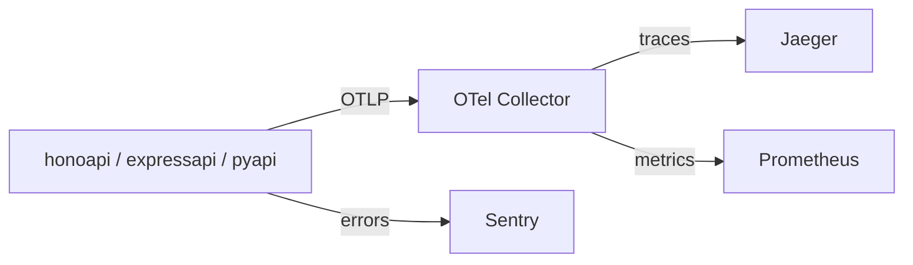

# Sentry + OTel 共存の調査メモ

以下は `honoapi` (Hono/Node.js) で auto-instrumentation と `@sentry/hono/node` を併用する際に調査した内容。

## 構成

- OTel: `--require autoinstrumentation.js` (OTel Operator スタイル) で起動前に SDK を初期化、OTLP で Collector → Jaeger へエクスポートする
- Sentry: `@sentry/hono/node` でエラー追跡のみ (トレースは OTel に任せる)



## 問題点

### 1. `tracesSampleRate: 0.0` は spans を有効にする

`@sentry/core` の `hasSpansEnabled()` は `typeof tracesSampleRate === 'number'` で判定するため、`0.0` でも `true` になる。
結果として Sentry の HTTP OTel instrumentation が有効化され、`otel.scope.name = @sentry/node` の span が OTel pipeline に混入する。

```
// NG: 0.0 でも hasSpansEnabled() が true になり Sentry の HTTP spans が生成される
tracesSampleRate: 0.0

// OK: undefined にすると hasSpansEnabled() が false になる
// tracesSampleRate を設定しない
```

### 2. `skipOpenTelemetrySetup` が `@sentry/hono/node` の型にない

`HonoNodeOptions extends Options<BaseTransportOptions>` (`@sentry/core` の薄い型) を使っているため、
`NodeOptions` にある `skipOpenTelemetrySetup` が TypeScript 型に含まれない。

- `@sentry/nestjs`: `NodeOptions` を直接使用 → 型アサーション不要
- `@sentry/nuxt`: `Parameters<typeof initNode>[0]` で参照 → 型アサーション不要
- `@sentry/hono/node`: 独自の薄い型 → **型アサーションが必要**

runtime では `@sentry/node` の `init()` にそのまま options を渡しているので動作はする。

### 3. `skipOpenTelemetrySetup` なしだと OTel pipeline が破壊される

`initOpenTelemetry()` → `setupOtel()` が以下をグローバルに上書きする：

- `BasicTracerProvider` (`SentrySpanProcessor` のみ) で TracerProvider を置き換え → auto-instrumentation の OTLP exporter が失われる可能性
- `SentryPropagator` で propagator を置き換え
- `SentryContextManager` で context manager を置き換え

`skipOpenTelemetrySetup: true` を設定することで Sentry が OTel に一切触らなくなる。

なお `SentryContextManager` がなくてもリクエスト分離 (isolation scope) は壊れない。
`httpServerIntegration` が診断チャネル経由で `withIsolationScope()` を明示的に呼ぶため。

### 4. `propagateTraceparent` による二重注入リスク

- デフォルト: `false`
- `true` にすると Sentry が `getTraceData()` 経由でリクエストに W3C `traceparent` を注入する
- `skipOpenTelemetrySetup` なしの場合は `SentryPropagator` も OTel レベルで inject するため二重になりうる
- `skipOpenTelemetrySetup: true` + `propagateTraceparent` デフォルト (`false`) なら問題なし

### 5. Profiling は `tracesSampleRate` が必要

`profileSessionSampleRate` (v10.27.0 以降の continuous profiling) も `profilesSampleRate` (deprecated) も、サンプリング基準が `tracesSampleRate` による。`tracesSampleRate` 未設定だと profiling も動かない。

## 推奨設定 (エラー追跡のみ)

```typescript
// instrument.ts
import * as Sentry from "@sentry/hono/node";
import type { NodeOptions } from "@sentry/node";

(Sentry.init as (options: NodeOptions) => ReturnType<typeof Sentry.init>)({
  dsn: process.env.SENTRY_DSN,
  skipOpenTelemetrySetup: true,  // OTel pipeline を守る
  // tracesSampleRate は設定しない  // hasSpansEnabled を false に保つ
  dataCollection: {},
});
```

`index.ts` の `sentry()` ミドルウェアはそのまま使える (`earlyPatchHono()` は import 時に実行されるため) 。

## まとめ

Sentry は OTel を「使う」のではなく「内包する」設計になっており、自前の OTel スタックと共存させると摩擦が生じやすい。
エラー追跡のみの用途であれば `skipOpenTelemetrySetup: true` ＋ `tracesSampleRate` 未設定で共存可能。

---

# Native Histogram (Exponential Histogram) の調査メモ

OTel SDK が送信する histogram を Prometheus native histogram (exponential bucket) にする調査。

## Python

環境変数だけで対応可能

```yaml
OTEL_EXPORTER_OTLP_METRICS_DEFAULT_HISTOGRAM_AGGREGATION: base2_exponential_bucket_histogram
```

Python auto-instrumentation は `sitecustomize.py` → `_OTelSDKConfigurator._configure()` → `OTLPMetricExporter()` のパスでこの env var を正しく読む。

## Node.js

### 問題: NodeSDK が env var を無視する ([issue #3920](https://github.com/open-telemetry/opentelemetry-js/issues/3920))

- `new NodeSDK()` の標準パスは `getMetricReadersFromEnv()` を使い、`OTEL_EXPORTER_OTLP_METRICS_DEFAULT_HISTOGRAM_AGGREGATION` を読まない。
- `startNodeSDK()` (experimental) は `@opentelemetry/configuration` 経由で読む。
  - → [PR #6874](https://github.com/open-telemetry/opentelemetry-js/pull/6874) として `NodeSDK` でも env var を読む修正を投げた

### 解決策: custom instrumentation image + register.js で aggregationPreference を明示する

`otel/autoinstrumentation-nodejs` をベースに custom image (`otel-autoinstrumentation-nodejs/`) を作成し、`autoinstrumentation.js`, `register.js` を変更する。
`OTLPMetricExporter` に `aggregationPreference` を直接渡すことで、exponential histogram として収集できる。

```js
// register.js の骨子
const sdk = new NodeSDK({
    metricReader: new PeriodicExportingMetricReader({
        exporter: getOtlpMetricExporterFromEnv(), // プロトコルと aggregation を env var から読む
    }),
    instrumentations: getNodeAutoInstrumentations(),
    resourceDetectors: getResourceDetectorsFromEnv(),
});
sdk.start();
```

サービス側は `OTEL_EXPORTER_OTLP_METRICS_DEFAULT_HISTOGRAM_AGGREGATION: base2_exponential_bucket_histogram` を追加するだけで native histogram が有効になる。

## OTel Operator での含意

Kubernetes で OTel Operator の auto-instrumentation + native histogram を使う場合:
- Node.js: `NodeSDK` の issue #3920 が修正されるまでは custom instrumentation image が必要 (env var から `aggregationPreference` を設定するため)
- Python: 標準の auto-instrumentation image で対応可能。
